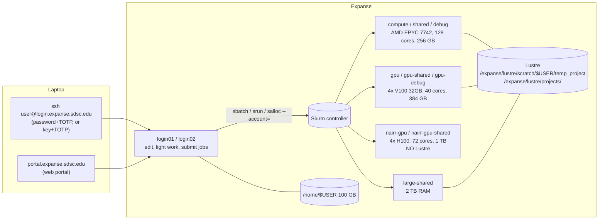

> **SDSC KB DOC** (written for hpcgpt-cli; not mirrored from upstream). A condensed, agent-oriented digest of what a researcher faces when they SSH into Expanse. The authority is the [Expanse User Guide](https://www.sdsc.edu/systems/expanse/user_guide.html) (checked against the live page, October 2026). When this page and the guide disagree, the guide wins; open an issue here.

# Expanse: access, login-node rules, modules, storage

## Mental model



## Logging in

| Item | Value |
|---|---|
| Hostname | `login.expanse.sdsc.edu` (assigns you to `login01` or `login02`) |
| Auth | ACCESS portal password + **TOTP** (2FA required), or an SSH key in `~/.ssh/authorized_keys` + TOTP |
| 2FA enrolment | <https://passive.sdsc.edu>: "Login using Globus" (choose **ACCESS CI**) for ACCESS users; "I have an invitation" for non-ACCESS users (ask consult@sdsc.edu) |
| Web | [Expanse User Portal](https://portal.expanse.sdsc.edu): files, job submission and monitoring, interactive apps (Jupyter, RStudio, MATLAB) |
| Rate limit | Hosts that open SSH connections more than ten times per minute "may get blocked for a short period of time". Tools that reconnect often should reuse one connection (`ControlMaster`). |
| Help | consult@sdsc.edu, or the [ACCESS help desk](https://support.access-ci.org/) |

Details and screenshots: [connect-to-expanse](https://github.com/sdsc-hpc-training-org/hpc-security/blob/master/connecting-to-hpc-systems/connect-to-expanse.md).
All rows above are from the [user guide, System Access](https://www.sdsc.edu/systems/expanse/user_guide.html#system-access).

## Login nodes: what's allowed

The login nodes are "meant for file editing, simple data analysis, and other tasks that use minimal compute resources".
**Not** allowed: computationally intensive processes, hosts for workflow-management tools, large or numerous data
transfers, or services reachable from the Internet. The guide also says users "should request an interactive
session" to compile programs.

What this means for an agent running in `opencode` on a login node:

- ✅ `squeue`, `sinfo`, `sacct`, `expanse-client`, `module spider`, reading files, writing job scripts.
- ✅ Short `python -c` checks and `bash -n` syntax checks.
- ❌ Running the user's training script "just to test", `pip install` of big CUDA wheels, `make -j`,
  multi-GB `rsync`/`cp`. Do these in an interactive job (`srun --pty`, see
  [slurm-on-expanse](slurm-on-expanse.md#interactive-jobs)) or a batch job.
- ❌ Long-lived servers (including an MCP server or `vllm serve`) on a login node. Run them inside a job.

## Modules (Lmod)

```bash
module spider <name>             # search everything (module avail hides packages until a compiler/stack is loaded)
module load cpu                  # CPU software stack (compute/shared/debug/large-shared)
module load gpu                  # GPU software stack; never load cpu and gpu together
module list
module purge && module restore   # what the guide says to run at the start of an interactive GPU job
```

- `module: command not found` inside scripts or non-login shells: `source /etc/profile.d/modules.sh`.
- `expanse-client: command not found`: `module load sdsc` (per the guide and the [expanse-client skill](../../skills/expanse-client/SKILL.md)).
- In batch scripts, start with `module purge`, then `module load gpu` (or `cpu`), `module load slurm`, and the
  application modules, as in the guide's job examples.
- Which stack the H100 (`nairr-gpu*`) nodes use isn't documented ([verify M6](verify-on-expanse.md)).
- Containers: `module load singularitypro`. SDSC provides Singularity images for PyTorch and TensorFlow
  ([user guide, Expanse AI Resource](https://www.sdsc.edu/systems/expanse/user_guide.html#expanse-ai-resource)).
- Example job scripts live on the system in **`/cm/shared/examples/sdsc/`**. Point users there first.

Sources: [user guide, Modules](https://www.sdsc.edu/systems/expanse/user_guide.html#modules) and
[Running Jobs](https://www.sdsc.edu/systems/expanse/user_guide.html#running-jobs-on-expanse).

## Storage

| Path | Size / policy | Use for | Gotcha |
|---|---|---|---|
| `/home/$USER` | 100 GB; backups kept on a rolling 8-week period | code, scripts, small envs | **Never run jobs from `$HOME`** |
| `/expanse/lustre/scratch/$USER/temp_project` | Lustre scratch; ≤ 2 M files per user; **not backed up**; files purged **90 days after creation** | active job I/O | Jobs must request `--constraint="lustre"` **or they get scheduled on nodes without Lustre and fail** |
| `/expanse/lustre/projects/...` | Lustre project space; **not backed up**; purged **90 days after the allocation expires** | shared project data | same constraint. The usual layout is `<project>/$USER`, but the guide doesn't state it ([verify S15](verify-on-expanse.md)) |
| `/scratch/$USER/job_$SLURM_JOB_ID` | node-local NVMe: 1 TB (compute/shared), 1.6 TB (gpu, gpu-shared), 3.2 TB (large-shared), ~6 TB (nairr) | fast temp I/O, checkpoints | **deleted when the job ends**; copy results out |
| Ceph object store (Expanse AI resource) | S3 interface; each user gets S3 credentials; data kept for the project's duration | persistent data for `nairr-gpu*` jobs | Lustre isn't mounted on the H100 nodes. Install `s3cmd` yourself (pip or conda) |

The [guide](https://www.sdsc.edu/systems/expanse/user_guide.html#storage) says users are responsible for backing up their own data. Many small files on Lustre (conda envs,
`pip install` into scratch, millions of images) load the metadata server, and the guide asks users with heavy
small-file I/O to contact support. Prefer containers, tar or squashfs datasets, or node-local scratch.
Source: [user guide, Storage](https://www.sdsc.edu/systems/expanse/user_guide.html#storage) and
[Expanse AI Resource](https://www.sdsc.edu/systems/expanse/user_guide.html#expanse-ai-resource).

## Data transfer

Use **Globus** for anything big. The Lustre file systems are exposed through the "SDSC HPC - Expanse Lustre" and
"SDSC HPC - Projects" collections ([user guide, Data Movement](https://www.sdsc.edu/systems/expanse/user_guide.html#data-movement)).
`scp`/`rsync` over `login.expanse.sdsc.edu` is fine for small files. For secure Jupyter/port forwarding,
see [SSH tunneling](https://github.com/sdsc-hpc-training-org/hpc-security/blob/master/ssh_methods/ssh-tunneling-is-more-secure.md).

## Jupyter

- Easiest: the portal's Jupyter app.
- CLI: **[galyleo](https://github.com/sdsc/galyleo)**. On Expanse run `export PATH="/cm/shared/apps/sdsc/galyleo:${PATH}"`
  (the README documents a `galyleo` module only for TSCC). It submits a Slurm job and returns
  an HTTPS URL on `*.expanse-user-content.sdsc.edu`. Example, with a conda environment file
  ([mkandes/notes 2026/06/13b](https://github.com/mkandes/notes/blob/main/2026/06/13b.md)):
  `galyleo launch --account <project> --partition debug --cpus 16 --memory 32 --time-limit 00:30:00 --conda-yml env.yaml`.

## Commands the agent runs

The login-node rules above apply to **every command the agent runs** on the user's behalf. Setup:
[../hpcgpt-cli/dev-workflow.md](../hpcgpt-cli/dev-workflow.md).
