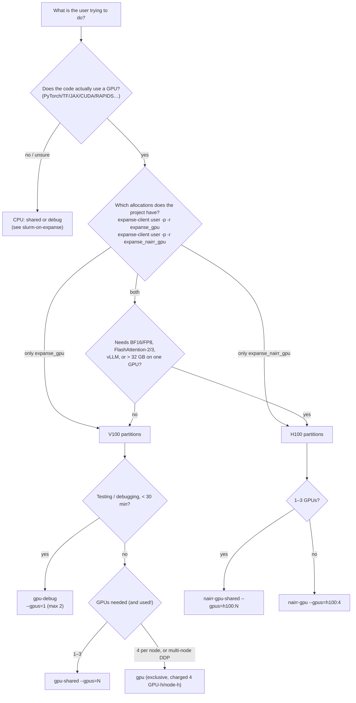

> **SDSC KB DOC** (written for hpcgpt-cli; not mirrored from upstream). Decision guide for GPU requests on Expanse (basis for a planned `expanse-gpu-request` skill). Hardware and partition facts come from the [user guide](https://www.sdsc.edu/systems/expanse/user_guide.html) (checked against the live page, October 2026). The memory-sizing rules of thumb are **our heuristics** (standard ML arithmetic), not SDSC policy.

# Choosing and right-sizing a GPU on Expanse

## What exists

| | V100 nodes | H100 nodes ("Expanse AI resource") |
|---|---|---|
| Partitions | `gpu-debug`, `gpu-shared`, `gpu`, `gpu-preempt` | `nairr-gpu-shared`, `nairr-gpu` |
| Per node | 4× **V100 SXM2 32 GB** (NVLink), 2×20-core Xeon Gold 6248, 384 GB RAM, 1.6 TB NVMe | 4× **H100** (Dell XE9640), 2×36-core Intel Xeon, 1 TB RAM, 6.4 TB NVMe |
| Node count | 52 (208 V100s) per the [guide's table](https://www.sdsc.edu/systems/expanse/user_guide.html#technical-summary); its summary paragraph says 54 GPU nodes | 34 (136 H100s) |
| Allocation (`expanse-client` resource) | `expanse_gpu` (ACCESS) | `expanse_nairr_gpu` (**NAIRR Pilot only**) |
| `--gpus=` syntax | `--gpus=1` | **`--gpus=h100:1`** (type required) |
| Lustre | yes (`--constraint=lustre`) | **not mounted**: local NVMe + Ceph S3 |
| Compute capability | 7.0 (Volta): FP16 tensor cores; **no BF16, no TF32** | 9.0 (Hopper): BF16, FP8, TF32 |
| Debug queue | `gpu-debug` (30 min, ≤ 2 GPUs) | **none documented**; use `nairr-gpu-shared` with a short `-t` |

Compute capabilities are from [NVIDIA's CUDA GPU list](https://developer.nvidia.com/cuda-gpus).

> **There are no H200s on Expanse.** H200/H100/GH200/A100 GPUs exist on **NRP/Nautilus**
> (Kubernetes). There, A100s can be requested, but H100/H200/GH200 are reserved for the groups that contributed them
> ([NRP GPU pods](https://nrp.ai/documentation/userdocs/running/gpu-pods/)).
>
> The guide documents only V100 and H100 GPUs. However, at least one Expanse node (`exp-16-57`) has 4× A100-PCIE-40GB
> ([mkandes/notes 2026/09/04](https://github.com/mkandes/notes/blob/main/2026/09/04.md)). Its partition and who can
> use it aren't public, so don't offer A100s to users ([verify S13](verify-on-expanse.md)).
>
> H100 memory on the XE9640 is expected to be 80 GB. Confirm it with `nvidia-smi` ([verify S10](verify-on-expanse.md)).

## Decision flow



## Will it fit? GPU memory rules of thumb

Parameters are in billions (B). "Fits" means the weights plus working memory fit with ~20% headroom. V100 = 32 GB,
H100 = 80 GB (assumed, see above).

| Workload | Bytes per parameter (approx.) | 7B model | 13B | 70B |
|---|---|---|---|---|
| Inference, FP16/BF16 weights | 2 (+ KV cache) | ~14 GB: **V100 ✓** | ~26 GB: V100 tight; H100 ✓ | ~140 GB: 2× H100 is tight; 4× H100 (tensor parallel) |
| Inference, 4-bit quantized | ~0.6 | ~5 GB ✓ | ~8 GB ✓ | ~42 GB: 1× H100 ✓ / 2× V100 |
| LoRA fine-tune (FP16 base, frozen) | ~2 + activations | ~20 GB: V100 ✓ (small batch) | ~35 GB: H100 | multi-GPU H100 |
| QLoRA (4-bit base) | ~0.6 + activations | ~10 GB: V100 ✓ | ~16 GB: V100 ✓ | ~48 GB: H100 ✓ |
| Full fine-tune, mixed precision + Adam | ~16–18 + activations | ~120 GB: 4× H100 with ZeRO/FSDP (4× V100 only with offload) | ~230 GB: one 4× H100 node with ZeRO-3, tight | ~1.2 TB: impractical (a 4-node `nairr-gpu` job has 1.28 TB of GPU memory) |
| Classic CNN / small transformer training (ResNet-50, BERT-base) | n/a | usually < 16 GB: **V100 ✓**; H100 is overkill | | |

KV cache grows with context length × batch. Long-context inference (32k+ tokens) can need as much memory as the
weights.

## Software compatibility on V100 (the usual "why doesn't it work")

- **No BF16 in hardware.** Code or configs that default to `bf16=True` (many Hugging Face/LLM recipes) either error
  out or run slowly in emulation. Use `fp16=True` with loss scaling.
- **FlashAttention-2 needs Ampere or newer, and FlashAttention-3 needs Hopper**
  ([flash-attention README](https://github.com/Dao-AILab/flash-attention)). On V100, use PyTorch SDPA
  (`attn_implementation="sdpa"` in Hugging Face).
- **vLLM requires compute capability 7.5 or higher**
  ([vLLM GPU installation](https://docs.vllm.ai/en/latest/getting_started/installation/gpu.html), also quoted in
  [mkandes/notes 2026/09/04](https://github.com/mkandes/notes/blob/main/2026/09/04.md)), so it doesn't support V100
  (7.0). For vLLM, use H100.
- FP8 needs Ada or Hopper, which on Expanse means H100.

## Right-sizing (don't over- or under-request)

| Mistake | Consequence | Better |
|---|---|---|
| `--gpus=3` on `gpu-shared` for a script with no DDP/`torchrun` | Pays 3 GPU-h per hour, 2 GPUs idle | `--gpus=1`; check with `nvidia-smi` during a `gpu-debug` run |
| `gpu` (exclusive) for a 1-GPU job | Charged **4 GPU-h per hour** | `gpu-shared --gpus=1` |
| `--gpus=1` with no `--mem`/`--cpus-per-task` | Gets **1 CPU + 1 GB RAM** ([guide default](https://www.sdsc.edu/systems/expanse/user_guide.html#using-gpu-nodes)); data loader starves or OOMs | `--cpus-per-task=10 --mem=92G` per V100 (≈ one GPU-SU; boundary unverified, see below) |
| Well above ~10 CPUs or ~92 GB per V100 | Charged by the larger fraction, so > 1 SU per GPU-hour | Stay near a quarter node per GPU. The exact threshold is ambiguous ([allocations-and-sus](allocations-and-sus.md#charging), [verify A2](verify-on-expanse.md)) |
| H100 for a job that fits a V100 | Uses scarce NAIRR hours | V100 unless BF16/FP8/memory/speed demands H100 |
| Long interactive `gpu-shared` session left idle | Charged the whole time | `gpu-debug` for ≤ 30 min, batch jobs for real runs |
| `-t 48:00:00` "just in case" | Harder to backfill, so usually a longer wait | Estimate from a short run and add ~20% |

**Check actual use** before scaling up:

```bash
# inside the job (interactive), or attach with: srun --jobid=<id> --overlap --pty bash   (--overlap needs Slurm >= 20.11)
nvidia-smi --query-gpu=index,name,utilization.gpu,memory.used,memory.total --format=csv -l 5
# after the job
sacct -j <jobid> --format=JobID,Elapsed,AllocTRES%50,MaxRSS,State
```

Low GPU utilization (say under ~30%) often means a data-loading or CPU bottleneck (add CPUs, use local NVMe), not a
need for a bigger GPU.

## Canonical commands (fill in `<project>`)

```bash
# quick GPU debug session (V100); the guide's own example uses --mem=96G
srun -p gpu-debug -A <project> -N 1 --ntasks-per-node=10 --mem=92G --gpus=1 -t 00:30:00 --pty --wait=0 --export=ALL /bin/bash
# 2-GPU debug (max for gpu-debug)
srun -p gpu-debug -A <project> -N 1 --ntasks-per-node=20 --mem=184G --gpus=2 -t 00:30:00 --pty --wait=0 --export=ALL /bin/bash
# single H100 (NAIRR); 18 cores / 250G is a proportional quarter node, not a documented SU boundary
srun -p nairr-gpu-shared -A <project> -N 1 --ntasks-per-node=18 --mem=250G --gpus=h100:1 -t 01:00:00 --pty --wait=0 --export=ALL /bin/bash
```

After landing on the node, run `module purge; module restore` (as the guide says), then `module load gpu` and
`nvidia-smi`.
