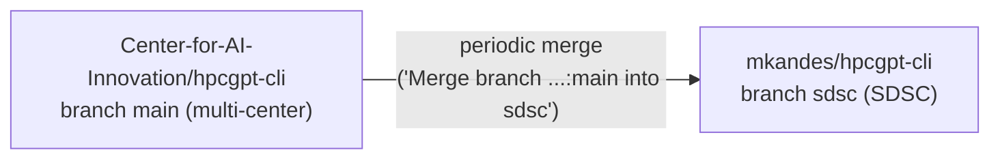
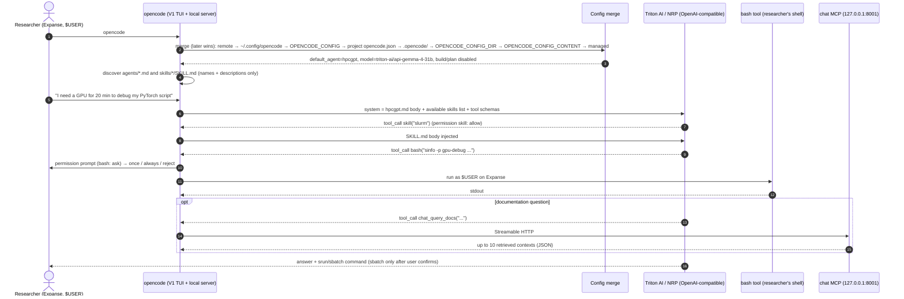
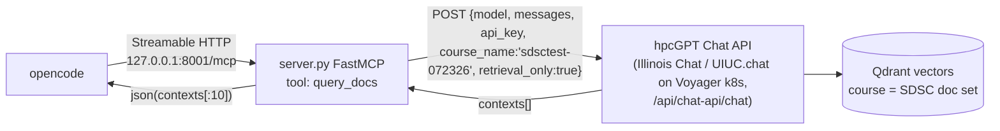

> **SDSC KB DOC** (written for hpcgpt-cli; not mirrored from upstream). Analysis of this repo at commit `ff700b0` (branch `sdsc` of `mkandes/hpcgpt-cli`, 2026-10-12). Line references use `<path>:<line>` from the repo root. The agent, skill and config-discovery behaviour below was checked locally on 2026-10-13 with `opencode-ai` 1.18.32 (`opencode agent list`, `opencode debug agent|skill|config`, `opencode mcp list` against a copy of `SDSC/`, dummy API keys, no LLM calls); nothing here was run on Expanse.

# hpcgpt-cli architecture (SDSC deployment)

## TL;DR

hpcgpt-cli **is not a program**. It is a set of **configuration packs for [OpenCode](../opencode/primer.md)**, one
directory per HPC center (`NCSA/`, `OSC/`, `TACC/`, `SDSC/`). There is no hpcgpt binary. Users run
`opencode`, and OpenCode loads the center's config, agent, skills, TUI plugins and MCP servers. The LLM is an
OpenAI-compatible endpoint: UCSD **Triton AI** today, with **NRP** defined but not enabled.

The SDSC pack is written for **OpenCode V1** (`opencode-ai` 1.18.x). See [../opencode/v1-vs-v2.md](../opencode/v1-vs-v2.md).

## Repo lineage and branches

- **SDSC work happens under `SDSC/` on branch `sdsc`.** Every commit touching `SDSC/` so far (2026-06-12 to
  2026-09-10) is by Marty Kandes. The other center folders are maintained upstream.
- `sdsc` merges upstream `main` from time to time. The merge at `6541176` (2026-09-10) contains all of `main` through
  2026-09-03. Upstream changes reach `SDSC/` only when they are copied in by hand, as with the NCSA plugins and
  modulefile on 2026-09-10 (`7cff637`, `9fe436d`).
- The root [`README.md`](../../../README.md) asks each center to keep `opencode.jsonc`, `prompts/`, MCP servers,
  `example.env` and a `README.md` in its own folder. `SDSC/` has no `example.env`.

## The SDSC pack, file by file

| Path | What it is | Loaded by | Status |
|---|---|---|---|
| `SDSC/opencode.jsonc` | Main OpenCode config: agents on/off, providers, default model, MCP | a config dir (`OPENCODE_CONFIG_DIR`, `~/.config/opencode/`) or `OPENCODE_CONFIG` | Active |
| `SDSC/agents/hpcgpt.md` | The **hpcGPT** primary agent: persona, permissions, escalation rules | agent discovery (`agents/` in a config dir) | Active, but see the bug below |
| `SDSC/skills/slurm/SKILL.md` | Slurm skill (client commands, guidelines, guardrails) | skill discovery (`skills/` in a config dir) | Draft v0.1.0 |
| `SDSC/skills/expanse-client/SKILL.md` | Skill for `expanse-client` (allocation/SU queries) | skill discovery | Draft v0.1.0 |
| `SDSC/tui.jsonc` | TUI config: theme + TUI plugins | `OPENCODE_TUI_CONFIG` | Added 2026-09-10 |
| `SDSC/plugins/slurm-sidebar/` | V1 **TUI plugin**: `/jobs` sidebar showing `squeue --me` + `sacct` since session start | `tui.jsonc` → `plugin` | Copied from NCSA |
| `SDSC/plugins/feedback/` | V1 TUI plugin: `/feedback` mails the session export via `mail` | `tui.jsonc` → `plugin` | Copied from NCSA |
| `SDSC/themes/sdsc.json` | SDSC colour theme | `themes/` in a config dir | "not yet complete", and unused (`tui.jsonc` sets `"theme": "system"`) |
| `SDSC/mcp/chat/` | FastMCP server exposing retrieval over SDSC docs from "hpcGPT Chat" (an Illinois Chat / UIUC.chat deployment on Voyager) | `opencode.jsonc` → `mcp.chat` (remote `http://127.0.0.1:8001/mcp`) | Prototype; see [known-issues](known-issues.md) |
| `SDSC/module.lua` | Lmod modulefile template for a site-wide install | Lmod (`module load hpc-gpt`) | Still the NCSA/Delta template |
| `SDSC/prompts/support.txt`, `report.txt` | Older system prompts (NCSA style) | **Nothing references them** | Legacy, superseded by `agents/hpcgpt.md` |
| `SDSC/README.md` | Skeleton headings only | none | Empty |

### Design shift: from MCP servers to agents + skills

Until 2026-07-11 the SDSC pack followed NCSA's design: Python FastMCP servers wrapping Slurm and allocation
commands, a Jira reporter, and a ticket-ingest pipeline. Commit `079cb68` (2026-07-11, "Clean up; rm all mcp servers")
removed all of them. On 2026-07-30 the pack was rebuilt around OpenCode's own primitives, and on 2026-09-10 a new
chat MCP server, the TUI plugins and the theme were added:

- **Agent** (`agents/hpcgpt.md`): persona and permissions.
- **Skills** (`skills/*/SKILL.md`): procedural knowledge. They teach the model to run real CLIs (`sbatch`,
  `squeue`, `expanse-client`) through the built-in `bash` tool, gated by `bash: ask`.
- **TUI plugins**: deterministic UI features that don't involve the LLM.
- **One MCP server** (`mcp/chat`, added in `2678d17`) for what the shell can't do: retrieval over the SDSC doc corpus.

**New capabilities should be skills first**, a plugin if the feature must not involve the LLM, and an MCP
server only if it needs a remote service or credentials that shouldn't be on the user's account. See
[extending-skills.md](extending-skills.md).

## Runtime: what happens when a researcher runs `opencode`

The diagram shows the **intended** flow, which is what you get once the agent-name bug
([known-issues A0](known-issues.md)) is fixed. In the current checkout the default agent has no SDSC prompt and
runs `bash` without asking.

Key properties:

- **Everything runs as the researcher.** The agent's shell is the researcher's own login-node shell, with no service
  account or sudo, and it is subject to login-node rules (see
  [../expanse/access-and-environment.md](../expanse/access-and-environment.md)). With `bash: ask`, every command
  needs approval unless the user picks "always".
- **Session state is OpenCode's.** Sessions and messages live under `~/.local/share/opencode/`
  ([troubleshooting](https://opencode.ai/docs/troubleshooting)). `snapshot: true` lets OpenCode snapshot and undo file
  changes, and `share: disabled` blocks share links. hpcgpt-cli keeps no state of its own; the feedback plugin reads the
  session through the plugin API (`api.state.session.messages`, `SDSC/plugins/feedback/index.tsx:37`).
- **Prompting has three layers:** the agent body (`agents/hpcgpt.md`: role, style, escalation); skill descriptions,
  which are always in context and decide *when* a skill loads; and skill bodies, loaded on demand. The agent sets
  `temperature: 0.1` (`SDSC/agents/hpcgpt.md:6`).
- **Tools** are OpenCode built-ins (`bash`, `read`, `grep`, `glob`, `webfetch`, `websearch`, `skill`, `question`,
  `todowrite`, ...) plus MCP tools, which are prefixed with the server name (for example `chat_query_docs`).
  Permissions are wildcard patterns on tool names ([agents: permissions](https://opencode.ai/docs/agents)).

### Agent `hpcgpt` permissions (`SDSC/agents/hpcgpt.md:7-20`)

| key | value | effect |
|---|---|---|
| `bash` | ask | every shell command needs approval; the only way to run anything |
| `edit`, `write`, `apply_patch` | deny | the agent can't modify files (in V1 the `edit` permission covers all three) |
| `read`, `grep`, `glob` | allow | free inspection of files the user can read |
| `skill` | allow | skills load without asking |
| `webfetch`, `websearch` | allow | web access; with the Triton AI/NRP providers, `websearch` exists only if `OPENCODE_ENABLE_EXA` (or `OPENCODE_ENABLE_PARALLEL`) is set, which the SDSC setup notes do |
| `question`, `todowrite` | allow | ask clarifying questions / keep a todo list |
| `lsp` | deny | no language-server tool |

> **Bug (reproduced with opencode 1.18.7, 1.18.23 and 1.18.32):** the frontmatter line `name: hpcGPT`
> (`SDSC/agents/hpcgpt.md:2`) gives the Markdown agent the id **`hpcGPT`**. `opencode.jsonc` enables and defaults to
> **`hpcgpt`**, which becomes a separate *bare* agent with no prompt and `'*': allow`. The table above describes
> `hpcGPT`, **not** the default agent users land in. See [known-issues A0](known-issues.md). With the `name:` line
> removed, the filename (`hpcgpt`) is the id, as the [agents docs](https://opencode.ai/docs/agents) describe, and
> `opencode agent list` shows a single `hpcgpt (primary)` with the SDSC prompt and permissions.

OpenCode's `build` and `plan` agents are disabled, so after the fix hpcGPT is the only user-facing primary agent. The
hidden built-ins (`compaction`, `summary`, `title`) and the `explore`/`general` subagents remain.

### Providers and models (`SDSC/opencode.jsonc`)

| provider id | baseURL | key env | models (key = API model id) | enabled? |
|---|---|---|---|---|
| `triton-ai` | `https://tritonai-api.ucsd.edu` | `TRITON_AI_API_KEY` | `api-gemma-4-31b` (**default**, line 18), `api-glm-5.3`, `api-glm-5.3-flash`, `api-cohere-transcribe`, `api-lightonocr-1b`, `api-muse-glimmer-30b`, `api-openai-privacy-filter` | **yes** (`enabled_providers`, line 16) |
| `nrp` | `https://ellm.nrp-nautilus.io/v1` | `NRP_LLM_API_KEY` | `deepseek-v4-flash`, `gemma`, `gemma-small`, `glm-5`, `gpt-oss`, `kimi`, `minimax-m2`, `qwen3`, `qwen3-small` | **no** (not in `enabled_providers`) |

Model lists as of `ff700b0`; both change often, so check the file before relying on a specific id.

To use NRP, see [../nautilus-nrp/llm-api-for-opencode.md](../nautilus-nrp/llm-api-for-opencode.md).
In a V1 custom provider, the **map key** (`gemma`, `api-gemma-4-31b`) is the model id sent to the API
([models](https://opencode.ai/docs/models)), and `"name"` is only the label shown in the UI. The NRP keys are the
correct aliases, but several labels are stale ([known-issues A10](known-issues.md)).

### Config discovery: the thing that trips people up

`OPENCODE_CONFIG=/path/SDSC/opencode.jsonc` loads **only that JSON file**. The `agents/` and `skills/` next to it are
**not** discovered: with only `OPENCODE_CONFIG` set, `opencode agent list` shows the bare `hpcgpt (all)` agent and
`opencode debug skill` lists no SDSC skills. What *is* scanned, per the V1 source at tag `v1.18.32`
(`packages/opencode/src/config/paths.ts`, `packages/opencode/src/skill/index.ts` in `anomalyco/opencode`):

| Scanned for | Locations, in order |
|---|---|
| **config dirs** (each: `opencode.json(c)`, `agent(s)/`, `mode(s)/`, `command(s)/`, `plugin(s)/`, `{skill,skills}/**/SKILL.md`) | `~/.config/opencode/` → every `.opencode/` from the cwd up to the git worktree root → `~/.opencode/` → **`$OPENCODE_CONFIG_DIR`** |
| extra skill roots | `~/.claude/skills/`, `~/.agents/skills/`, and `.claude/skills/` / `.agents/skills/` from the cwd up to the worktree. `OPENCODE_DISABLE_CLAUDE_CODE_SKILLS` drops the `.claude` ones; `OPENCODE_DISABLE_EXTERNAL_SKILLS` drops both. |
| config `skills.paths` | each path scanned for `**/SKILL.md`; relative paths resolve against the **working directory**, not the config file (confirmed locally) |
| config `skills.urls` | skill bundles pulled from URLs |

So there are three ways to load the whole SDSC pack:

| Method | Command | Notes |
|---|---|---|
| **`OPENCODE_CONFIG_DIR` (recommended for dev)** | `export OPENCODE_CONFIG_DIR=/abs/path/SDSC` | Loads `SDSC/opencode.jsonc` **and** `agents/` and `skills/` from that one dir, and overrides the global config. OpenCode writes into the dir: a `.gitignore` on any run, and `package.json` (`@opencode-ai/plugin` pinned to the running version), `package-lock.json` and `node_modules/` when a session or server starts. Point it at a copy if the checkout must stay clean. |
| **Copy into global config** (the [2026-07-26 setup note](https://github.com/mkandes/notes/blob/main/2026/07/26.md)) | `cp SDSC/opencode.jsonc ~/.config/opencode/ && cp -r SDSC/agents SDSC/skills ~/.config/opencode/` | Simple, but the copies go stale; re-copy after every pull. |
| **Site module** | `module load hpc-gpt/<ver>` | The NCSA template sets `OPENCODE_CONFIG` and `OPENCODE_TUI_CONFIG`, which for SDSC would load no agent file and no skills. Setting **`OPENCODE_CONFIG_DIR`** to the installed pack is enough for config, agents and skills; `SDSC/module.lua` doesn't do this yet ([known-issues B2](known-issues.md)). |

TUI settings and TUI plugins are separate: set `OPENCODE_TUI_CONFIG=/abs/path/SDSC/tui.jsonc`. The plugin entries in
it are relative paths (`./plugins/...`), presumably resolved against `tui.jsonc`; that is not verified here.
`{file:./x}` substitutions in `opencode.jsonc` resolve relative to **that config file**
([config](https://opencode.ai/docs/config)).

## MCP server `SDSC/mcp/chat` (documentation RAG)

- `retrieval_only: true`: the chat service returns retrieved chunks and the **agent's own model** writes the answer,
  which avoids a second LLM call (`SDSC/mcp/chat/server.py:39,49-55`).
- The chat backend runs on **Voyager** (Kubernetes: frontend, backend, Qdrant, Keycloak, MinIO, PostgreSQL and others),
  deployed by SDSC staff ([note 2026-08-14a](https://github.com/mkandes/notes/blob/main/2026/08/14a.md),
  [note 2026-09-10](https://github.com/mkandes/notes/blob/main/2026/09/10.md)). In those tests it was reached through
  `kubectl port-forward` plus an SSH tunnel (`ssh -N -L 3000:localhost:3000 login.voyager.sdsc.edu`), at
  `http://127.0.0.1:3000/api/chat-api/chat`.
- The server must be started (for example in a separate shell) before `opencode`, and the backend must be reachable
  first: `server.py` calls `verify_connection()` at startup and exits if the check fails
  (`SDSC/mcp/chat/server.py:189`). If the server isn't running, `opencode mcp list` shows `✗ chat failed` with an SSE
  connection error and the `chat_*` tools are missing from the session. How the TUI reports this is not verified; see
  [verify-on-expanse](../expanse/verify-on-expanse.md).

## TUI plugins (V1 API)

Both plugins are `TuiPluginModule`s (`@opencode-ai/plugin/tui`, `engines.opencode >=1.17.0` in their
`package.json`). They register **slash commands** with `api.keymap.registerLayer` and **sidebar slots** with
`api.slots.register`. Neither calls the LLM.

- `slurm-sidebar`: `/jobs` toggles the panel and `/jobs-refresh` refreshes it. It runs `squeue --me --noheader
  --format=%i|%T|%j` and `sacct --allocations --noheader --parsable2 --starttime <session start>
  --format=JobIDRaw,State,JobName,End`, each with a 5-second timeout (`SDSC/plugins/slurm-sidebar/slurm.js:60,86-110`).
- `feedback`: `/feedback` asks for a category, then a comment, then a confirmation, then runs
  `mail -r $HPCGPT_FEEDBACK_FROM -s ... -a hpcgpt-session.json $HPCGPT_FEEDBACK_EMAIL`. Exports over 5 MiB are
  refused (`SDSC/plugins/feedback/mail.js:5,18-37`).

**These will not run on OpenCode V2**, which has a new plugin API and reads `cli.json` instead of `tui.json`. See
[../opencode/v1-vs-v2.md](../opencode/v1-vs-v2.md).

## Other centers (for patterns to borrow)

| Center | Notable pieces | Worth borrowing for SDSC |
|---|---|---|
| NCSA (Delta) | `client-deployment/` (installer, modulefile, `support`/`debug`/`learning` agents, `/report` command), 4 MCP servers, ticket-ingest pipeline | Granular `bash` permission map in `NCSA/client-deployment/delta-opencode.jsonc` (for example `sbatch *: ask`, `rm *: deny`); the agent split |
| OSC | Dockerised chat MCP server (`OSC/mcp_servers/osc_chat_server`), Helm chart (`charts/osc-mcp`) and image-build workflows (`.github/workflows/`) | How to host an MCP server centrally instead of per user |
| TACC | Slurm, chat and report MCP servers (the older pattern) | none |

See also: [known-issues.md](known-issues.md) · [extending-skills.md](extending-skills.md) · [dev-workflow.md](dev-workflow.md)
