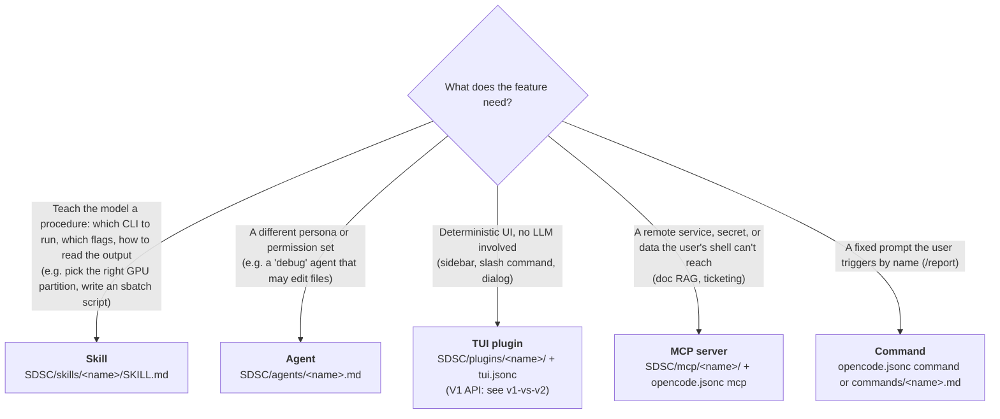
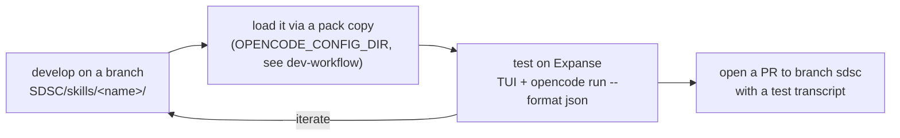

> **SDSC KB DOC** (written for hpcgpt-cli; not mirrored from upstream). How new capabilities are registered, implemented and tested in the SDSC pack, following the conventions of the existing skills in `SDSC/skills/`. The discovery and name-validation behaviour was checked locally with opencode 1.18.32 (`opencode debug skill`, no LLM calls); the trigger-test recipe has not been run. General skill-writing guidance is in [../opencode/skill-authoring.md](../opencode/skill-authoring.md).

# Adding a skill (or agent / plugin / MCP tool) to hpcgpt-cli SDSC

## 1. Which extension point?



The SDSC pack is **skills first** (see [architecture](architecture.md#design-shift-from-mcp-servers-to-agents--skills)).
Tasks like "request a GPU debug node without knowing the flags" or "which GPU do I actually need" are skills: the
model runs `sinfo`, `srun` and `expanse-client` itself through `bash`, so no server is needed.

## 2. Where it lives and how it's registered

There is **no registry file**. OpenCode discovers skills by directory:

```text
SDSC/skills/
  slurm/SKILL.md              # v0.1.0
  expanse-client/SKILL.md     # v0.1.0
  <your-skill>/               # new
    SKILL.md                  # required
    references/*.md           # optional: loaded only when SKILL.md points the model at them
    scripts/*.sh|py           # optional: executables the model runs via bash
    assets/                   # optional: templates (e.g. sbatch templates)
```

Registration checklist:

1. **Directory name == `name:` in frontmatter**, matching `^[a-z0-9]+(-[a-z0-9]+)*$` (1–64 chars). The
   [OpenCode docs](https://opencode.ai/docs/skills) and the [Agent Skills spec](https://agentskills.io/specification)
   require this, but OpenCode 1.18.32 does not enforce it: it loads any `SKILL.md` whose `name` is a string (a skill
   named `Bad_Name` in `wrong-dir/` was listed by `opencode debug skill`). Follow the rule anyway, since other
   clients and validators do check it.
2. **The skill has to be reachable by discovery.** The pack's `skills/` dir must end up under
   `~/.config/opencode/`, a `.opencode/` dir, or `OPENCODE_CONFIG_DIR` (see
   [architecture: config discovery](architecture.md#config-discovery-the-thing-that-trips-people-up)). Skill names
   are global: if two discovered skills share a name, the one scanned last wins and a warning is logged.
3. **The agent has to be allowed to load it.** The SDSC agent has `skill: allow` (`SDSC/agents/hpcgpt.md:16`). To gate a
   risky skill, add a pattern such as `"permission": {"skill": {"*": "allow", "expanse-*": "ask"}}` to
   `opencode.jsonc` or the agent frontmatter. The last matching rule wins, so put `"*"` first.
4. If the agent prompt lists skills by name (it doesn't today), update `agents/hpcgpt.md`.

## 3. SDSC conventions (from the existing skills)

Frontmatter, as the existing SDSC skills write it (with `updated` quoted, see [known-issues C](known-issues.md#c-skill-quality-nits-cheap-wins)):

```yaml
---
name: expanse-gpu-request
description: >
  <What it does + WHEN to use it, with the words users actually type:
  "GPU", "debug node", "srun", "interactive", "V100", "H100", "which GPU">
license: MIT
compatibility: opencode
metadata:
  author: <Your Name> (<you>@ucsd.edu)
  updated: "2026-10-12"
  version: 0.1.0
---
```

- OpenCode recognizes only `name`, `description`, `license`, `compatibility` and `metadata` (a string→string map).
  Other fields are ignored.
- Body sections: `slurm` uses Overview, Documentation, Source Code, How It Works, Client Commands, Guidelines,
  Guardrails, Common Problems, References. `expanse-client` uses Overview, Availability, Commands, Example Usage
  (command + output), References.
- Real command output from Expanse is the most valuable content. Capture your own with a test account and redact
  usernames and project codes that aren't yours.
- Guardrails are phrased as absolutes ("Never submit a job using the `sbatch` command without a confirmation by the
  user"). They are *advisory*; enforcement comes from permissions (`bash: ask`).

## 4. Develop → test → contribute



Use one branch per skill, named after it (for example `skill/<name>`).

### Load a skill under development

```bash
# on Expanse (or locally for syntax checks); refresh the pack copy after each edit (dev-workflow step 0)
rsync -a --delete --exclude kb/ --exclude node_modules/ SDSC/ ~/.cache/sdsc-pack/
sed -i '/^name: hpcGPT$/d' ~/.cache/sdsc-pack/agents/hpcgpt.md   # A0 fix, until it lands on sdsc
opencode debug skill                # the new skill must be listed
opencode debug config | less        # resolved config (providers, agents, permissions)
opencode agent list                 # hpcgpt must be listed as primary, once
```

Inside the TUI, ask a triggering question and watch for a `skill` tool call, then approve or deny the `bash` calls it proposes.

### Scripted trigger tests (cheap evals)

`opencode run` runs headless, and `--format json` prints raw events, so you can check whether the skill loaded.
**Apply the A0 fix to your pack copy first** (above): without it, `--agent hpcgpt` is the bare agent with
`'*': allow`, and a scripted loop would run every proposed command, `sbatch` included, without asking.

```bash
# should trigger
for q in "I need a GPU for 20 minutes to debug my PyTorch script" \
         "what flags do I use for an interactive V100 session?" \
         "is an H100 overkill for fine-tuning a 7B model?"; do
  opencode run --agent hpcgpt --format json "$q" \
    | grep -q 'expanse-gpu-request' && echo "PASS  $q" || echo "MISS  $q"
done
# should NOT trigger (precision)
opencode run --agent hpcgpt --format json "how do I compress a directory with tar?" | grep -q 'expanse-gpu-request' && echo "FALSE POSITIVE"
```

- Without `--auto`, `opencode run` **auto-rejects** every `ask` permission (V1 source, `packages/opencode/src/cli/cmd/run.ts`
  at `v1.18.32`), so with the fixed agent the test sees the skill load but no command runs. Don't pass `--auto` (or
  its aliases `--yolo`, `--dangerously-skip-permissions`): it approves everything that isn't explicitly denied,
  including `sbatch`.
- The JSON event shape of a skill call is **unverified**, and grepping for the skill name also matches it if the
  model merely mentions it. Inspect one run's output first and tighten the grep to the skill tool-call event
  ([checklist](../expanse/verify-on-expanse.md)).
- For output-quality evals (did it pick `gpu-debug` with `--gpus=1` and a sane `--mem`?), follow
  [evaluating skills](https://agentskills.io/skill-creation/evaluating-skills): fixed prompts, expected
  properties, and a comparison run with the skill disabled (`"permission": {"skill": {"<name>": "deny"}}`; denied
  skills are hidden from the agent).
- Test with the model users will actually get: `api-gemma-4-31b` on Triton AI is the default.

### Contributing

1. Commit `SDSC/skills/<name>/` on its branch, push, and open a PR against `sdsc`.
2. Link a test transcript (redact usernames and project codes that aren't yours) and the trigger-test results.

## 5. Other extension points (short)

| Add... | Files | Registration | Test |
|---|---|---|---|
| **Agent** | `SDSC/agents/<id>.md` (frontmatter: `description`, `mode: primary\|subagent`, `model`, `temperature`, `permission`; **no `name:`**, or it replaces the filename as the id) | The filename is the id, and agents in a discovered `agents/` dir are enabled by default. An `"agent": {"<id>": {...}}` block in `opencode.jsonc` is only needed to override settings; if its key doesn't match the agent's id it creates a second, bare agent ([A0](known-issues.md)). Optionally set `default_agent`. | `opencode agent list`; `opencode debug agent <id>`; `opencode run --agent <id>` |
| **TUI plugin (V1)** | `SDSC/plugins/<name>/{package.json,index.tsx}`, exporting a `TuiPluginModule` with `id` and `tui(api)` | Append `"./plugins/<name>"` to `plugin` in `SDSC/tui.jsonc` | Needs `OPENCODE_TUI_CONFIG=.../SDSC/tui.jsonc`; use `api.keymap.registerLayer` for slash commands. **Won't run on V2.** |
| **MCP tool** | Python FastMCP server under `SDSC/mcp/<name>/` (copy the `chat` layout; fix [A1–A6](known-issues.md) first) | `"mcp": {"<name>": {"type": "remote", "url": "http://127.0.0.1:<port>/mcp"}}` or `"type": "local", "command": [...]` | `opencode mcp list`; tools appear as `<name>_<tool>` |
| **Command** | `"command": {"<name>": {"template": "{file:./prompts/<name>.txt}", "agent": "hpcgpt"}}` | in `opencode.jsonc` | Type `/<name>` in the TUI |
